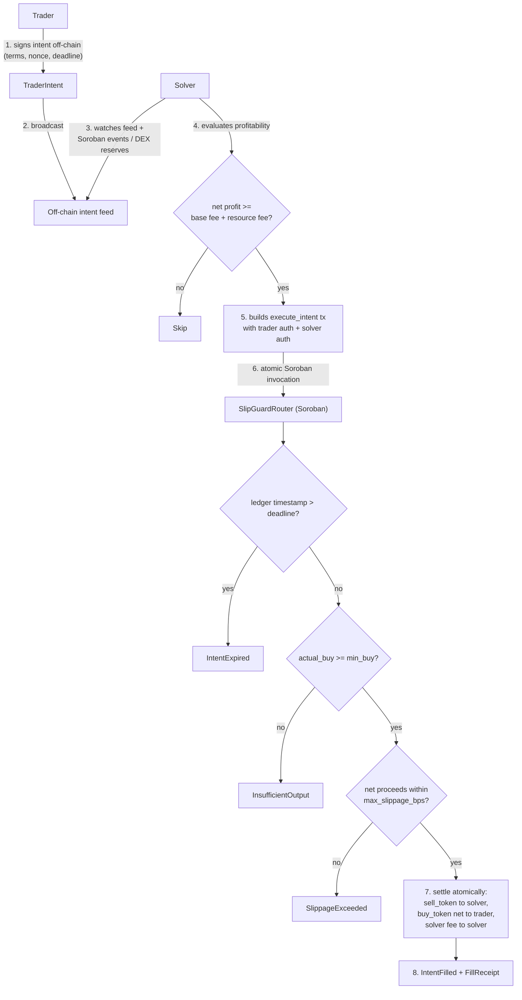

# SlipGuard

**Intent-based conditional orders with enforced slippage protection, implemented entirely as Soroban contracts on Stellar.**

[](./LICENSE)
[](https://stellar.org)
[](https://crates.io/crates/soroban-sdk)
[](https://github.com/SlipGuard-HQ/stellar-slipguard/actions/workflows/ci.yml)
[](./pnpm-workspace.yaml)
[](https://slipguard-hq.github.io/stellar-slipguard/)

SlipGuard lets a trader express an order as a signed, off-chain **intent** ("sell exactly this much XLM, and I will not accept less than this much USDC, and I will not wait past this deadline") and lets any solver fill it on chain. The router is the only component that moves funds, it is non-custodial, and it reverts any fill that breaks the trader's stated terms.

The protocol has no other execution environment. Settlement is a Soroban contract invocation, the trader's consent is a Soroban authorization entry, the clock is the Stellar ledger timestamp, the assets are SEP-41 tokens (including the Stellar Asset Contract), and every read and write goes through Stellar RPC. There is no EVM code path, no Solidity, no chain-agnostic abstraction layer and no off-chain settlement.

---

## Stellar and Soroban are the implementation, not the deployment target

Each property below is required for SlipGuard to work at all. Removing it breaks the protocol rather than degrading it. The full mapping from primitive to file is in [Stellar integration map](./docs/06-stellar-integration.md).

| Stellar / Soroban primitive | Where SlipGuard depends on it | Effect if it did not exist |
| --- | --- | --- |
| `Address::require_auth()` with an invocation-scoped authorization entry | `execute_intent` requires **both** the solver and the trader, and the trader's entry binds the exact token addresses, amounts, deadline and nonce | The trader would have to hand custody or a blanket approval to a solver |
| Soroban pre-signed authorization entries (`SorobanAuthorizationEntry`, ledger-bounded, base64 over the intent feed) | `@slipguard/sdk` `prepareExecuteIntent`, `packages/solver-bot/src/executor.ts` | Fills would require the trader to be online and co-sign every transaction |
| `env.ledger().timestamp()` | The deadline check inside `execute_intent` | Expiry would be a client-side promise, not an enforced term |
| Instance and persistent storage with explicit TTL extension (17,280 ledgers ≈ 1 day) | `contracts/router/src/storage.rs`, `contracts/mock_token/src/lib.rs` | Intent status and fill receipts would be archived and the replay guard would weaken |
| `env.crypto().sha256()` over the `ScVal` XDR encoding of a `#[contracttype]` struct | `get_intent_hash`, reproduced byte-for-byte by `hashIntent` in the SDK | There would be no stable, verifiable order identity |
| The SEP-41 token interface (`soroban_sdk::token::TokenClient`) | All four settlement transfers, including against the Stellar Asset Contract for XLM and issued assets | Every asset would need bespoke integration code |
| `MuxedAddress` (CAP-27) in the SEP-41 transfer signature | Token movements in `execute_intent` and `MockToken` | Muxed destinations could not be paid |
| Stellar RPC (`simulateTransaction`, `assembleTransaction`, `sendTransaction`, `getTransaction`, `getEvents`, `getLatestLedger`) | `SlipGuardClient` and `IntentWatcher` | Nothing could be read, priced or submitted |
| The `stellar` CLI (`contract deploy`, `contract asset deploy`, `contract invoke`, `keys`) | `scripts/deploy.sh` | Deployment and demo asset setup would be manual |
| Native 100-stroop base fee plus a Soroban resource fee priced on measured CPU and I/O | The solver's profitability model (`TX_COST`) | Small conditional orders would be fee-dominated and not worth filling |
| Five-second ledger close time | Deadline semantics, event cursor handling, the solver's poll interval | Seconds-long deadlines would be meaningless |

## The problem

A market order does not tell you the price you will get. On an automated market maker, the price is a function of the pool state at the moment your transaction lands: any pending order is an invitation to be sandwiched by a searcher who buys ahead of you, lets you move the pool, and sells behind you. Slippage limits are a damage cap, not a protection: they let you be filled at the worst price you said you would tolerate, and nothing better.

Limit orders fix the price but not the execution. On a 5-second ledger, a resting order needs a solver to notice it and submit a fill, and that solver needs a reason to act. SlipGuard makes the solver's incentive explicit and puts the trader's constraints in the execution path itself, so a fill that does not meet them cannot settle.

## How it works



The trader's funds never leave their wallet until a fill succeeds, and the pull only happens under the trader's own Soroban authorization. There is no escrow account, and no SEP-41 allowance to manage.

## Why Stellar and Soroban

- **The fee ceiling is not the constraint.** Stellar's base fee is 100 stroops (0.00001 XLM) per operation, and Soroban adds a resource fee that is priced per unit of CPU and I/O the contract actually uses. A working solver does not have to net a large spread before a fill is worth submitting, which is what makes small conditional orders viable instead of fee-dominated.
- **Five-second ledgers make a resting intent useful.** A deadline measured in seconds is meaningful when the chain closes a ledger roughly every five seconds. Off-chain intents with on-chain enforcement only make sense when the gap between signing and settling is short.
- **Soroban's auth model is the mechanism, not a detail.** `Address::require_auth()` is checked inside the contract, so `execute_intent` can require *both* the solver and the trader to authorize the exact argument set. The trader is not trusting the solver with a blank cheque: the signature binds the tokens, amounts, deadline and nonce. The trader can hand a pre-signed authorization entry to any solver without giving up control of the fill price.
- **SEP-41 tokens are composable.** The router calls the standard token interface, so it works with the Stellar Asset Contract for XLM and any issued asset, plus any SEP-41 token deployed on Soroban. `scripts/deploy.sh` deploys against Stellar Asset Contracts; the bundled `MockToken` exists only so the test suite has a token to settle against offline.

## Repository layout

```
stellar-slipguard/
├── contracts/
│   ├── router/            # SlipGuardRouter: hashing, cancellation, settlement
│   └── mock_token/        # SEP-41 token implementation used by the test suite
├── packages/
│   ├── sdk/               # @slipguard/sdk: build, hash and submit intents
│   └── solver-bot/        # @slipguard/solver-bot: reference solver daemon
├── scripts/
│   ├── deploy.sh                    # deploy SACs + router, initialize, in dependency order
│   └── create-stellar-backlog.sh    # create the Stellar-scoped issue backlog in one run
├── docs/                  # protocol, end-user, developer and Stellar integration docs
├── deployments/           # checked-in testnet contract addresses
├── assets/                # banner and other static assets
├── .github/               # CI, lint workflow, issue and PR templates
├── Cargo.toml             # Rust workspace (soroban-sdk 26)
├── pnpm-workspace.yaml    # pnpm workspace
└── package.json           # root scripts
```

## Quickstart

Requires Rust (stable, with the `wasm32v1-none` target), Node 20 or newer, and pnpm 12. The `stellar` CLI is only needed to deploy.

```bash
git clone https://github.com/SlipGuard-HQ/stellar-slipguard.git
cd stellar-slipguard

# Rust toolchain and Soroban WASM target (rust-toolchain.toml pins these)
rustup target add wasm32v1-none

# JavaScript dependencies
pnpm install

# Run everything
pnpm test
```

Individual pieces:

```bash
cargo test --all                             # Soroban contract unit tests (soroban-sdk testutils)
cargo build --target wasm32v1-none --release # release WASM artifacts

pnpm build:packages                          # compile both TypeScript packages
pnpm test:packages                           # SDK and solver bot tests
pnpm lint                                    # builds, typechecks, prettier, clippy
pnpm format                                  # rewrite files with Prettier
```

The compiled contracts land in `target/wasm32v1-none/release/`:

- `slipguard_router.wasm`
- `slipguard_mock_token.wasm`

## Documentation

**Live site:** <https://slipguard-hq.github.io/stellar-slipguard/>

The same pages are also readable as plain Markdown in [`docs/`](./docs/README.md):

| Page | Contents |
| --- | --- |
| [Introduction](./docs/01-introduction.md) | The problem, the intent model, and why Soroban's auth model is load-bearing. |
| [Protocol mechanics](./docs/02-protocol-mechanics.md) | Intent lifecycle, settlement order, and the fee and slippage math with worked numbers. |
| [End-user guides](./docs/03-end-user-guides.md) | How to trade with an intent, and how to run a solver profitably. |
| [Developer guide](./docs/04-developer-guide.md) | Setup, SDK reference, the Stellar RPC call pattern, configuration and deployment. |
| [Contract architecture](./docs/05-architecture.md) | Contract responsibilities, dependency graph, storage and TTL policy, and every entry point with its auth and events. |
| [Stellar integration map](./docs/06-stellar-integration.md) | Every Stellar and Soroban primitive the repository depends on, and the file that depends on it. |

## Testnet deployment

A live testnet deployment is checked in under [`deployments/`](./deployments/README.md):

| Contract | Address |
| --- | --- |
| `SlipGuardRouter` | `CBNWLNZKYA2FASRFVURBBX4JGHXJAZGJAKCKANB4MQGIKI7NXBFB5HON` |
| Demo XLM (`MockToken`) | `CBW2W4NQ4IY23DH4NCB2YZBNKLWNQPDR53HDBYHM256BLXQZ5ZLR5MFM` |
| Demo USDC (`MockToken`) | `CB37MCA7VBKY3WFBK2SXLJROT2HTSL4HK4HSX62PT6A5SWVDFYJ2K7PB` |

[Explorer](https://stellar.expert/explorer/testnet/contract/CBNWLNZKYA2FASRFVURBBX4JGHXJAZGJAKCKANB4MQGIKI7NXBFB5HON). The demo tokens are test-only SEP-41 instances, not real assets, and the router is unaudited.

Verify the deployment yourself with the Stellar CLI:

```bash
stellar contract invoke \
  --id CBNWLNZKYA2FASRFVURBBX4JGHXJAZGJAKCKANB4MQGIKI7NXBFB5HON \
  --network testnet -- get_admin
```

## Deploying

`scripts/deploy.sh` works in dependency order against a Stellar network: it
deploys the **Stellar Asset Contracts** for the pair you name, deploys the
router, calls `init(admin)`, and prints a copy-pasteable summary of every
contract id. It writes the resolved ids to `.deploy/contracts.<network>.env` for
the app layer.

```bash
pnpm build:contracts
DRY_RUN=true ./scripts/deploy.sh        # print the plan, touch nothing

# Deploy against real Stellar assets (SAC): "native" for XLM, or CODE:ISSUER.
SELL_ASSET=native \
BUY_ASSET="USDC:GBBD47IF6LWK7P7MDEVSCWR7DPUWV3NY3DTQEVFL4NAT4AQH3ZLLFLA5" \
./scripts/deploy.sh

# Offline / test-only fallback: deploy two SEP-41 MockToken instances instead.
DEPLOY_MOCK_TOKENS=true ./scripts/deploy.sh
```

`SELL_ASSET` and `BUY_ASSET` are resolved with
`stellar contract asset deploy --asset <asset>`, so the router settles against
the same contracts that hold XLM and issued assets on Stellar. The mock token
path exists for the test suite and for local sandboxes; it is never a
production asset.

## Stellar-scoped issue backlog

`scripts/create-stellar-backlog.sh` creates the labels and the full issue
backlog with the `gh` CLI. Every issue names the Stellar or Soroban surface it
touches (SAC, SEP-41, Soroban auth, storage TTL, Stellar RPC, the `stellar`
CLI) and carries scoped acceptance criteria plus a tech stack line.

```bash
DRY_RUN=true ./scripts/create-stellar-backlog.sh
./scripts/create-stellar-backlog.sh
```

## Contract reference

`SlipGuardRouter` is the settlement layer. Every function below is a Soroban entry point.

| Function | Authorization | Returns | Purpose |
| --- | --- | --- | --- |
| `init(admin)` | `admin.require_auth()` | `Result<(), SlipGuardError>` | One-time protocol setup. Reverts with `AlreadyInitialized` on a second call. |
| `get_intent_hash(intent)` | none | `BytesN<32>` | SHA-256 over the intent's canonical `ScVal` XDR encoding. |
| `cancel_intent(intent)` | `intent.trader.require_auth()` | `Result<(), SlipGuardError>` | Withdraw an active intent. Consumes the nonce so it can never fill. |
| `execute_intent(solver, intent, actual_buy_amount)` | `solver.require_auth()` **and** `intent.trader.require_auth()` | `Result<FillReceipt, SlipGuardError>` | Settle the order atomically. |
| `get_intent_status(intent_hash)` | none | `IntentStatus` | `Active`, `Filled` or `Cancelled`. See the note below. |
| `get_fill_receipt(intent_hash)` | none | `Option<FillReceipt>` | Settlement proof for a filled intent. |
| `is_nonce_used(trader, nonce)` | none | `bool` | Whether a `(trader, nonce)` pair has been consumed. |
| `get_admin()` | none | `Option<Address>` | The admin set by `init`. |

### Intent fields

| Field | Type | Meaning |
| --- | --- | --- |
| `trader` | `Address` | The account selling `sell_token`. |
| `sell_token` | `Address` | SEP-41 token (or Stellar Asset Contract) pulled from the trader on fill. |
| `buy_token` | `Address` | SEP-41 token the solver must deliver. |
| `sell_amount` | `i128` | Exact `sell_token` amount moved to the solver. |
| `min_buy_amount` | `i128` | Gross `buy_token` amount the solver must deliver. |
| `max_slippage_bps` | `u32` | Maximum shortfall, in basis points, between `min_buy_amount` and the trader's net proceeds. |
| `deadline` | `u64` | Stellar ledger timestamp (unix seconds) after which the intent cannot fill. |
| `nonce` | `u64` | Per-trader single-use replay guard. |
| `solver_fee_bps` | `u32` | Fee, in basis points of the fill, retained by the solver. |

`IntentStatus::Expired` is defined so the enum is complete, but it is never written to storage: expiry is a function of the ledger clock, not of the intent, and it is enforced by the deadline check inside `execute_intent`. An intent whose deadline has passed but which was never filled or cancelled still reads `Active`.

### Errors

| Code | Name | Raised when |
| --- | --- | --- |
| 1 | `IntentExpired` | `ledger().timestamp() > deadline`. |
| 2 | `InsufficientOutput` | `actual_buy_amount < min_buy_amount`. |
| 3 | `SlippageExceeded` | The trader's net proceeds fall further below `min_buy_amount` than `max_slippage_bps` allows. |
| 4 | `UnauthorizedTrader` | The solver is also the intent's trader. |
| 5 | `NonceAlreadyUsed` | The `(trader, nonce)` pair has already been consumed. |
| 6 | `IntentNotActive` | The intent is `Filled` or `Cancelled`. |
| 7 | `MathOverflow` | A checked arithmetic operation overflowed. |
| 8 | `InvalidSlippageBps` | A basis-point value exceeds 10,000. |
| 9 | `InvalidAmount` | `sell_amount` or `min_buy_amount` is not strictly positive. |
| 10 | `AlreadyInitialized` | `init` was called twice. |

### Settlement order and safety

`execute_intent` follows checks-effects-interactions: intent status and the nonce are written **before** any token transfer, so a hostile token contract cannot re-enter and fill the same order twice. Every arithmetic operation is checked, all fee math is integer basis points with `i128`, and the contract is `#![no_std]` with no floating point anywhere.

## Authorization model

A fill moves tokens in four steps, all in one Soroban invocation:

1. `sell_token`: `trader -> solver`, for `sell_amount`.
2. `buy_token`: `solver -> router`, for `actual_buy_amount`.
3. `buy_token`: `router -> trader`, for `actual_buy_amount - solver_fee`.
4. `buy_token`: `router -> solver`, for `solver_fee`, when the fee is non-zero.

Steps 1 and 2 are authorized by the trader and the solver respectively. Steps 3 and 4 are authorized by the router itself, which is the contract making the call. The trader's authorization is a Soroban authorization entry scoped to the exact `execute_intent` invocation. The tokens, amounts, deadline and nonce are all part of the signed payload, so handing a pre-signed authorization entry to an untrusted solver does not let that solver change the terms.

## Using the SDK

```ts
import { IntentBuilder, SlipGuardClient, hashIntent, NETWORKS } from "@slipguard/sdk";

const intent = new IntentBuilder()
  .setTrader(traderPublicKey)
  .setPair(xlmSacId, usdcSacId)
  .setAmounts(100_000_000n, 95_000_000n) // sell 10 XLM, accept at least 9.5 USDC
  .setSlippageBps(50) // tolerate 0.50% of the minimum after fees
  .setSolverFeeBps(10) // solver keeps 0.10% of the fill
  .setDeadline(600) // valid for 10 minutes
  .setNonce(1n)
  .build();

// Off-chain hash, byte-for-byte identical to SlipGuardRouter::get_intent_hash
console.log(hashIntent(intent));

const client = new SlipGuardClient({
  contractId: "C...",
  ...NETWORKS.testnet,
  publicKey: traderPublicKey,
});

const onChainHash = await client.getIntentHash(intent);
const status = await client.getIntentStatus(intent);
```

The SDK is strict by default: addresses are validated as Stellar strkeys (account, muxed and contract), amounts must be positive integers, basis points must be within `[0, 10000]`, and a deadline in the past is rejected at build time.

## Running the solver bot

The reference solver watches an intent feed and router events through Stellar RPC, checks that a fill is both valid under the contract's rules and profitable after the base fee and Soroban resource fee, then submits the transaction and polls for ledger inclusion.

```bash
cp .env.example .env
# set ROUTER_CONTRACT_ID and SOLVER_SECRET_KEY
DRY_RUN=true pnpm --filter @slipguard/solver-bot start
```

Set `DRY_RUN=false` once you have confirmed the bot is reading real intents. The daemon logs one JSON object per line and shuts down cleanly on `SIGINT` or `SIGTERM`.

## Security

The contracts are unaudited and have not been deployed to Stellar mainnet. Do not commit real keys, and do not point the solver at a mainnet contract with a funded account until the code has been reviewed. See [SECURITY.md](./SECURITY.md) for the disclosure process.

## Maintainers

| Maintainer | Role | Contact |
| --- | --- | --- |
| SlipGuard HQ | Protocol design, Soroban contracts, tooling | [@SlipGuard-HQ](https://github.com/SlipGuard-HQ) |

Feature requests and integration questions are welcome on the issue tracker. There
is no private support channel; keeping the discussion public keeps the answers
useful to the next person.

## Contributing

Read [CONTRIBUTING.md](./CONTRIBUTING.md) before opening a pull request. Every PR should reference an issue, pass CI, and include tests for new behaviour. The full planned backlog lives in the [issue tracker](https://github.com/SlipGuard-HQ/stellar-slipguard/issues), labelled by Stellar surface and difficulty.

## Community

- **Questions, ideas and integration help:** open a [GitHub issue](https://github.com/SlipGuard-HQ/stellar-slipguard/issues) or reach the maintainers through the [@SlipGuard-HQ](https://github.com/SlipGuard-HQ) organisation.
- **Soroban development questions:** the [Stellar developer Discord](https://discord.gg/stellardev) is where the ecosystem answers contract and RPC questions.
- **Security reports:** do not open a public issue. Follow [SECURITY.md](./SECURITY.md).

## License

[MIT](./LICENSE)

## Contributors

<a href="https://github.com/SlipGuard-HQ/stellar-slipguard/graphs/contributors">
  
</a>
